# 冷战热斗 · Twilight Struggle 网页复刻


《Twilight Struggle》是一款两个人对坐、一人扮美国一人扮苏联、从 1945 年打到 1989 年的卡牌驱动桌游。这个仓库是它的网页版：规则按 20 周年版做全，110 张卡、84 个国家都在，可以离线和电脑打，也可以开房间和朋友在线打。整套服务放在 Cloudflare Workers 免费计划上。

> 这是个人做来自己玩的非商业项目。规则和卡牌文字的版权属于 GMT Games，美术是自己画的，没有用 GMT 的任何图。喜欢这个游戏的话，请支持正版。

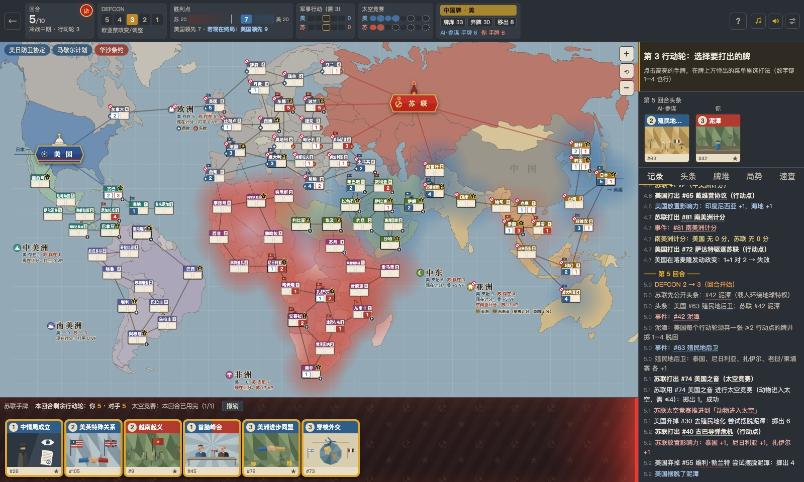

*第 5 回合，冷战中期。地图上的红晕、蓝晕是「现在打出计分卡谁领先」：非洲苏联领先 7 分，红得最浓；亚洲美国领先 5 分，泛蓝。欧洲、亚洲的方框左上角带禁止图标，因为 DEFCON 3 下这两个洲不能政变。*

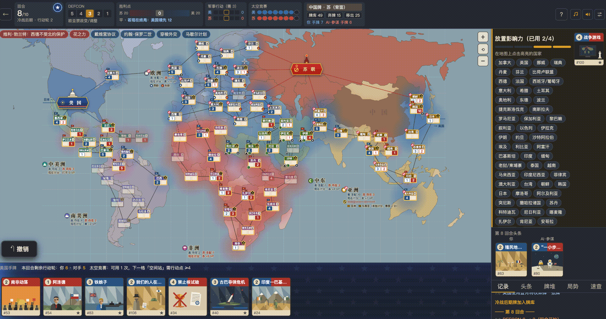

*实机录屏：第 8 回合，美国用「战争游戏」的 4 点行动力放置影响力，地图上的晕色随落子实时变化。*

## 怎么玩

- **离线人机**：引擎和 AI 都在浏览器里跑，断网也能玩，存档留在本机，随时能撤销
- **在线人机**：开房间时选 AI 当对手
- **在线双人**：6 位房间码或邀请链接进房；支持断线重连、悔棋申请、认输、聊天、观战、战绩和复盘
- **开局选项**：美方额外影响力 0～3 点、要不要加入 #104–110 可选卡、阵营自选或随机
- **AI 三档**：新兵（随手出，但不会把自己送进核战争）、参谋（按局面打分）、将军（参谋的基础上往后多看几步）

第一次玩可以先走一遍新手教程，对局里也会在关键时刻弹提示，比如手里的计分卡再不打就要判负了。

## 游戏里有什么

### 出牌：在牌上方选打法

点一张手牌，牌的正上方会弹出一列选项：事件、行动点、太空竞赛；选了行动点再接着选放影响力、政变还是调整阵营。卡面全文和「按当前局面算」的预估就贴在旁边。数字键 1–4 也能直接选。

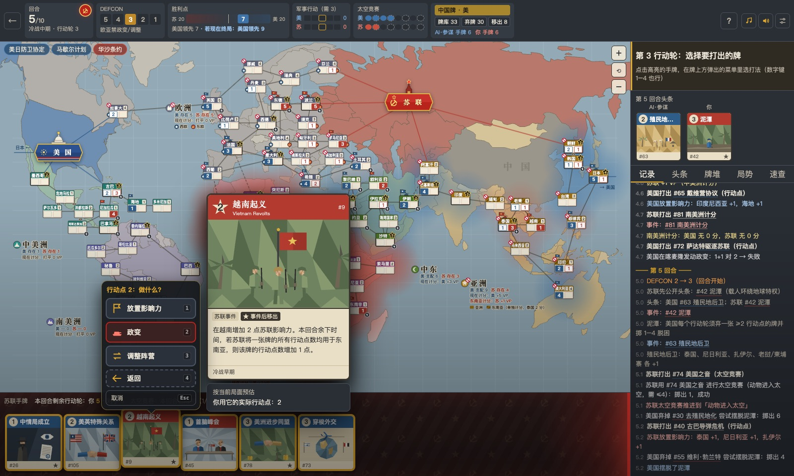

### 事件动画

每张牌打出事件时都有一段几秒钟的小动画：朝鲜战争是炮火，古巴导弹危机是导弹升空，柏林墙是砖块垮塌，花之力是满屏落花。对手用这张牌当行动点时，卡面上会盖一个「行动点 ×N · 事件不发动」的章，一眼就能分清。

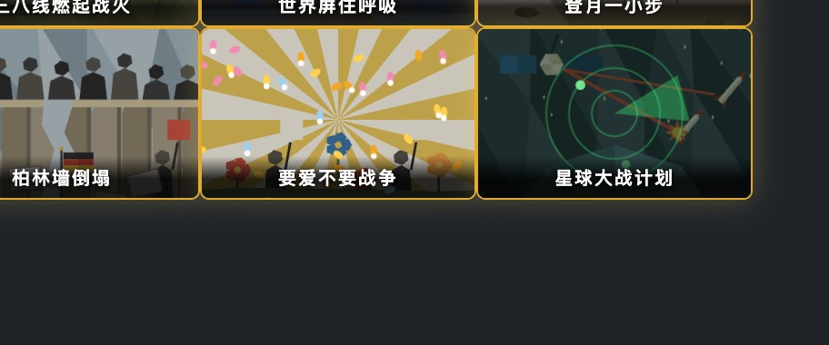

### 区域计分预览

点地图上的洲名，能看到这个洲现在打出计分卡的结果：双方各是存在、支配还是控制，控制了几个战场国，邻接对方本土的国家有几个，最后净得几分。计分卡此刻在谁手里、在不在弃牌堆，也一并列出来。

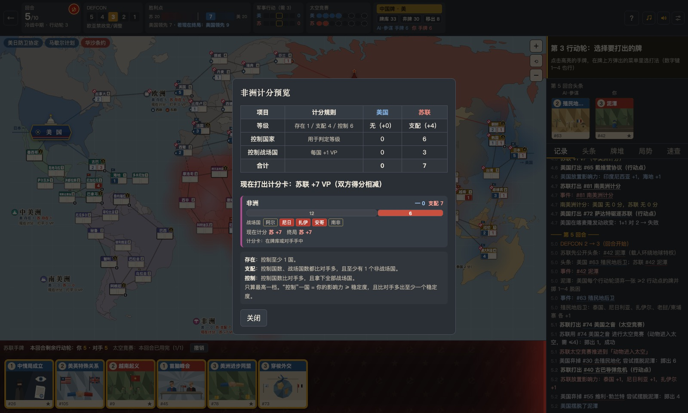

### 顶栏的几条轨道

回合、DEFCON、胜利点、军事行动、太空竞赛、中国牌都在顶栏。鼠标停在上面能看说明和当前数字，比如胜利点那一栏会算出「如果现在就终局计分」每个洲各得多少。

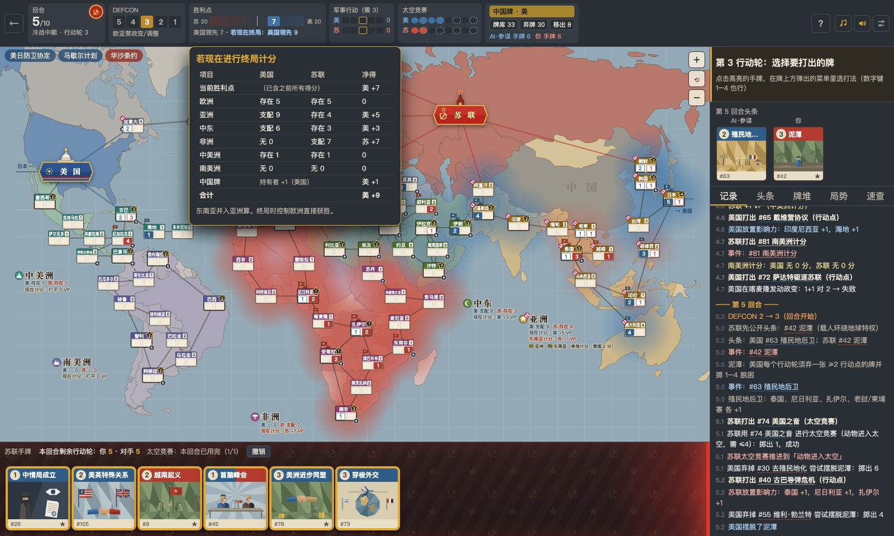

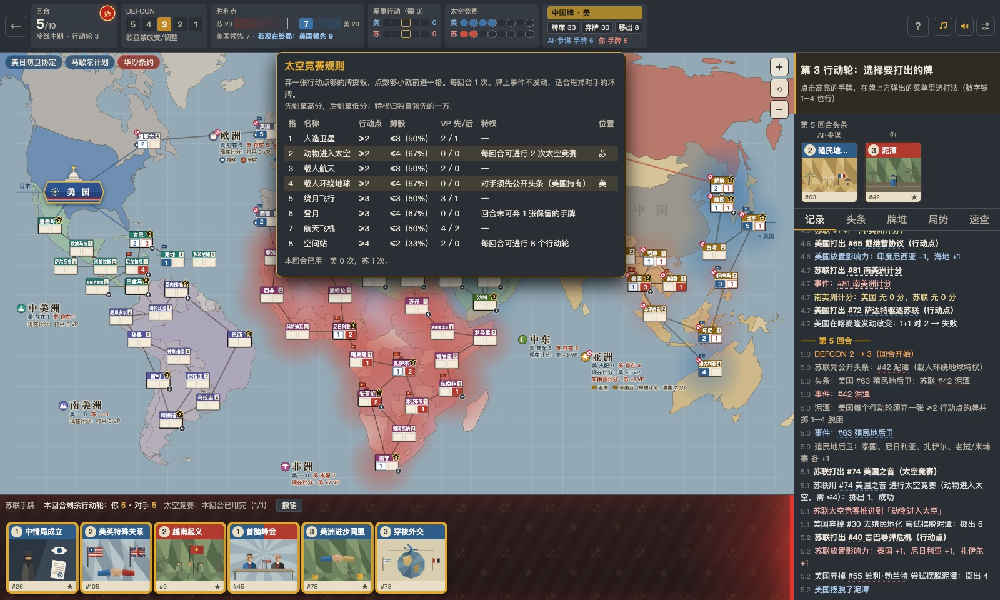

### 点名某个国家的卡

日本、埃及、伊朗、古巴这类被特定卡牌点名的国家，方框右下角有个小闪电。点开能看到这些卡属于哪个时期、现在在哪：已经生效、已经移出游戏、在弃牌堆、在你手里，或者还没洗进牌库。

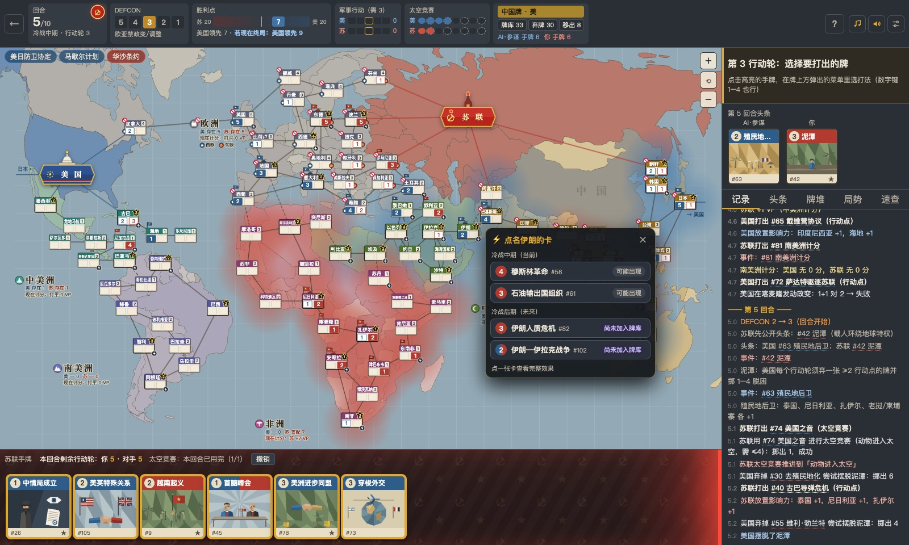

### 卡牌图鉴

110 张卡（外加 36 张不死不休专属卡）的插画都是手写 SVG 拼出来的 low poly 小画，可以按时期、阵营筛选，也能按卡名或编号搜。

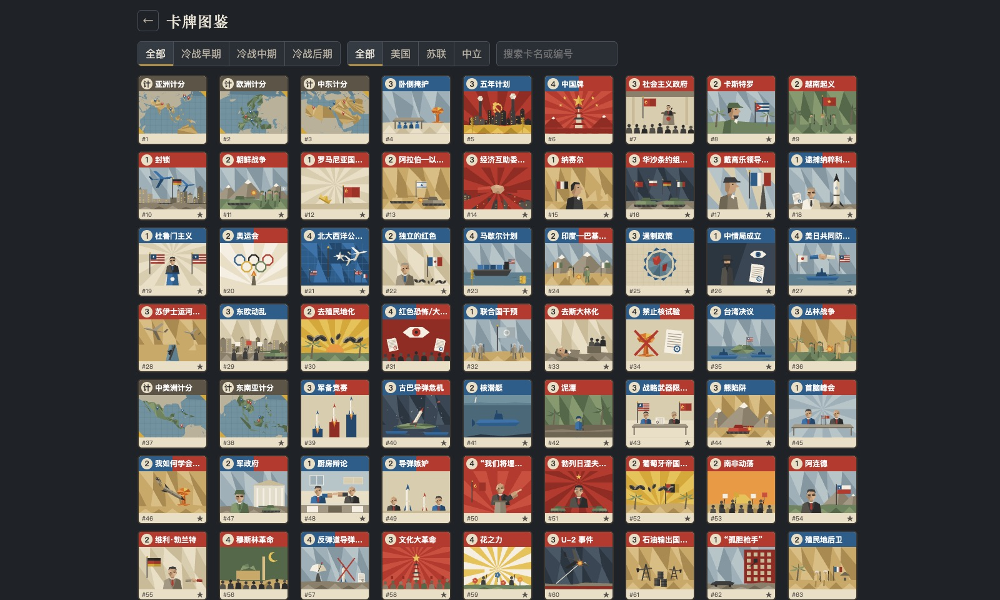

### 冷战后期与终局

到了后期，桌面上的持续事件会越堆越多（顶部那一排标签），地图也更容易被一方染成大片颜色。下图是第 8 回合：苏联领先 10 分，手里的「战争游戏」可以选择给美国 6 分然后直接结束对局，右侧面板把两种选择的结果都算好了。

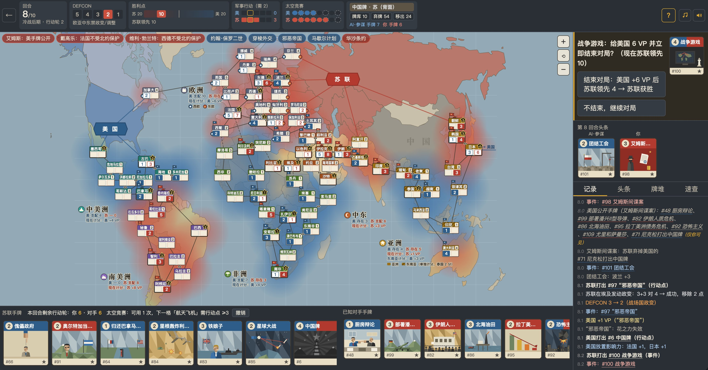

打满 10 回合会做终局计分，列出每个洲和中国牌各得多少分。苏联赢是满屏红潮加镰刀锤子旗，美国赢是自由女神、星条旗和烟花。

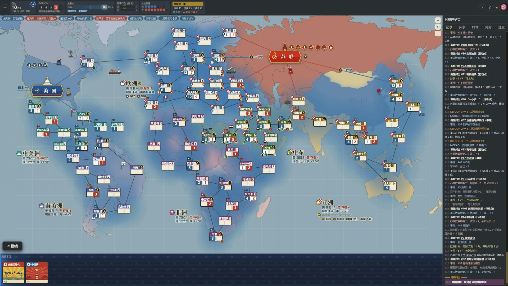

*一局打满 10 回合的终局：美国在终局计分时控制欧洲直接获胜，大半个世界被染成蓝色。地图上留着这一局里发生过的事件：加拿大的雷达站、大西洋的援助货船、阿富汗冒烟的坦克、北京的乒乓球拍……鼠标停上去能看到每件事的历史背景。*

### 剧本

开局前可以选剧本：标准 1945 开局、柏林危机、古巴导弹危机、缓和年代、最后的冷战。剧本决定从第几回合开始、DEFCON、胜利点、太空竞赛、各国影响力、哪些事件已经发生，还附一段背景故事。离线人机和在线建房都能选。

「管理 / 编写剧本」页可以自己写剧本（以内置剧本为底稿改写也行），支持导入导出 JSON，上传后所有人可见。内置剧本都是原创内容，没有照搬官方的 Turn Zero 等扩展。

### 不死不休

和 AI 打完一局（核战争除外），结算界面多一个「继续：不死不休」。冷战不再在第 10 回合结束，没有回合上限，一方控制全部战场国、外加对手本土的全部邻国才算赢。从第 11 回合起：

- **没有头条**：每回合补牌后直接进入行动轮
- **换牌**：原来三个时期的牌全部退场，牌库换成 36 张不死不休专属牌（卡牌图鉴里单独一栏）
- **不再计分**：胜利点冻结；事件里的「+N VP」改为得分方立刻获得 N 点行动点，桌上持续事件给的 VP 改为影响力
- **世界变化**：中国成为亚洲战场国、蒙古走上棋盘，澳大利亚和菲律宾成为美国本土邻国；中国牌换成「联合国牌」（4 点，持有方每控制英、法、中之一 +1）
- **区域红利 / 区域压制**：支配一个洲每个行动轮前多 1 点免费影响力，控制多 2 点；控制的洲每回合开始清扫洲内敌方影响力
- **乌云压境**：占着对手本土邻国，会削减对手每回合第一张行动点牌
- **轨道打击**：太空竞赛到顶后，每次成功都能在未被控制的洲免费政变一次
- **石油经济**：苏联每回合按控制的石油国数量免费放影响力
- **中国统一 / 朝鲜半岛统一**：一方同时控制中国和台湾、或朝鲜和韩国时，两国合并，带来持续的红利

回合开始和行动轮开始各做一次结算，固定调整和放置影响力合在一起说明；地图上的洲名旁有阵营徽章，支配的洲站着士兵、控制的洲开进坦克。

### 其他细节

- 世界地图用 Natural Earth 的真实国界，按棋盘布局拉伸变形；欧洲和非洲按实体棋盘的比例放大
- 鼠标停在国家上会显示政变和调整阵营的成功率
- 对手已经亮过的手牌、牌库里还剩哪些牌，都能在侧栏查到
- 背景音乐和音效全部用 Web Audio 现场合成，仓库里没有音频文件
- 手机横屏也能玩，地图支持双指缩放；装成 PWA 后可以离线打开

## 规则说明

基础规则按 20 周年纪念版：也就是 Deluxe 版规则，加上默认加入的 #104–110 可选卡，以及「回合结束时手里还有计分卡直接判负」这一条。每张卡都写了单元测试。

- 地图和卡牌数据用 Deluxe 版
- 没有做 Turn Zero、Red Sun Rising、促销卡和替代太空轨
- 规则书没写清楚、或者社区有争议的地方（比如穿梭外交管不管终局计分、联合国干预取消掉的带星卡去哪），统一记在 [`docs/rulings.md`](docs/rulings.md)，主要参考 GMT 的 FAQ 和 DeepStruggle 的规则审计

游戏里也有「规则摘要」页和侧栏的「速查」。

## 技术架构

| 层 | 选型 |
|---|---|
| 前端 | Vite + Preact + @preact/signals，SVG 地图与卡面 |
| 规则引擎 | TypeScript，生成器描述流程，所有输入都是“选择”。对局 = 随机种子 + 选择序列，可完整回放 |
| 隐藏信息 | 视图过滤 `viewFor(game, side)` 是唯一出口，对手手牌与牌库顺序不会下发 |
| 在线服务 | Cloudflare Worker 入口 + Durable Objects（每局一个 `GameDO`，单例 `LobbyDO`）+ D1（用户、战绩） |
| 离线 | Web Worker 跑引擎与 AI，存档存 localStorage，Service Worker 缓存静态资源 |

```
src/
  data/     地图与卡牌数据（由 scripts/gen-data.ts 从开源数据生成）
  engine/   规则引擎：game.ts（流程与行动）、effects/（110 张卡事件）、scoring.ts、view.ts
  ai/       AI：局面评估、行动点规划、事件估值
  art/      卡牌插画：kit/（low poly 图元）、cards/（逐卡场景）
  client/   前端：game/（棋盘、地图、手牌、离线 Worker、在线会话）、pages/、audio.ts
  worker/   服务端：index.ts（路由与鉴权）、game.ts（GameDO）、lobby.ts（LobbyDO）
  shared/   前后端协议
test/       单元测试（规则、逐卡、AI、插画）
scripts/    数据生成、地图生成、随机对局冒烟、AI 对战、插画预览
docs/       开发计划、规则与平台调研、规则裁定、参考数据
```

## 本地开发

需要 Node.js 22+。

```bash
npm install
echo "SESSION_SECRET=$(openssl rand -hex 32)" > .dev.vars
cp wrangler.jsonc wrangler.local.jsonc        # 本地也读这个文件
npm run db:migrate:local                      # 本地 D1
npm run dev                                   # Vite + workerd，前端与 Worker / DO / D1 同一个开发服务器
```

常用脚本：

```bash
npm test                                  # 全部单元测试
npx tsx scripts/sim.ts 100                # 随机对局冒烟（检查不变量）
npx tsx scripts/ai-match.ts 2 1 10        # AI 对战：美方档位 苏方档位 局数
npx tsx scripts/preview-art.ts            # 生成 dist-art/preview.html，预览全部卡牌插画
npm run gen:data                          # 重新生成 src/data/*.gen.ts
npx tsx scripts/gen-worldmap.ts <ne_110m_admin_0_countries.geojson>   # 重新生成地图底图
```

## 部署到自己的 Cloudflare 账号

免费计划即可（Durable Objects 使用 SQLite 后端）。

```bash
npx wrangler login
npx wrangler d1 create cold-war-db
# 把输出的 database_id 填进 wrangler.local.jsonc（该文件已被 .gitignore 忽略，不要提交）
npm run db:migrate
npx wrangler secret put SESSION_SECRET -c wrangler.local.jsonc
# 可选：删除玩家剧本用的密码（不设则为 123456）
npx wrangler secret put SCENARIO_ADMIN_PASSWORD -c wrangler.local.jsonc
npm run deploy
```

部署后访问 Cloudflare 分配的默认子域即可；需要自定义域名时，在 `wrangler.local.jsonc` 里加 `routes: [{ "pattern": "你的域名", "custom_domain": true }]`。

免费额度说明：静态资源不计请求数；每局对战只在一个 Durable Object 里运行，按“每个选择写一行”持久化，个人使用远低于每日额度。额度在 UTC 0 点重置。

## 数据来源与致谢

- 地图拓扑与卡牌数据：[tomjefferys/twilight-struggle-rs](https://github.com/tomjefferys/twilight-struggle-rs)（MIT）
- 规则裁定、中文译名与卡牌说明底稿：[mihaild/DeepStruggle](https://github.com/mihaild/DeepStruggle)（MIT）
- 世界地图国界：[Natural Earth](https://www.naturalearthdata.com/) 1:110m（公有领域）
- 架构参考：Cloudflare Durable Objects、WebSocket Hibernation 官方文档

## 版权

源代码与原创美术以 MIT 许可发布（见 [LICENSE](LICENSE)）。《Twilight Struggle》的游戏规则、卡牌名称与卡牌文本版权归 GMT Games 所有，不在 MIT 许可范围内；本仓库仅出于个人非商业目的使用，如权利方有异议请联系删除。
